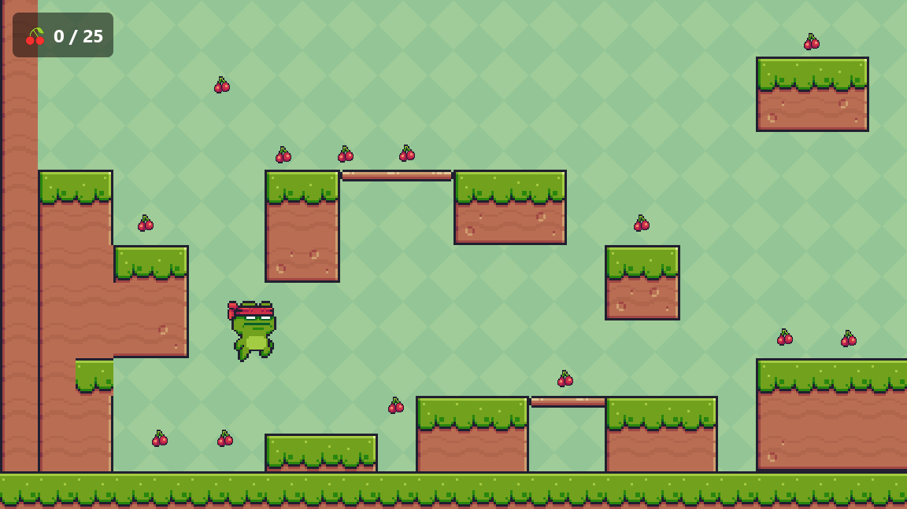
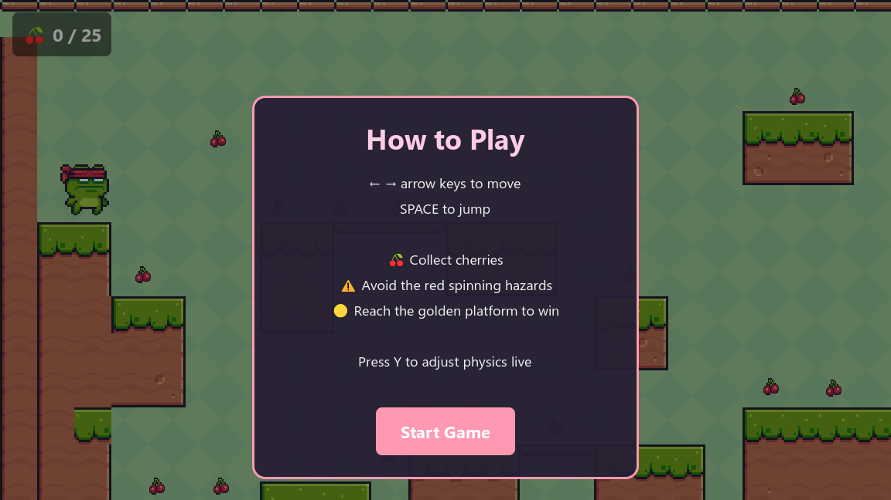

# Basic Platformer

*A small 2D platformer where the physics are the point: springboards, platforms that carry you, hazards that spin — and a panel that lets you rewrite gravity while you play.*

### ▶ [Play it in your browser](https://nex2406.github.io/basic-platformer/)

No download needed. Works in Chrome, Edge or Firefox on a computer with a keyboard.

  

---

## How to play

| Key | Action |
|---|---|
| ← → | Move |
| Space | Jump |
| Y | Open the live physics panel |

Collect the **25 cherries**, avoid the **red spinning hazards**, and reach the **golden platform** to finish the level. The counter in the top-left keeps score.

  

## The physics

Each part of the level is built around one idea from mechanics:

- **Springboards — Hooke's law.** Three springs fling the player high into the air, up to platforms a normal jump can't reach.
- **Moving platforms — reference frames.** Three platforms carry the player with them; standing still on one still means moving through the world.
- **Rotating hazards — angular motion.** Four hazards spin at a steady angular velocity across the paths between platforms. Touch one and you respawn.
- **Live physics panel.** Press **Y** at any time to change **gravity** (default 9.8 m/s²), **jump strength** and **run speed** while the game is running, then reset to the defaults.

## How it's built

- **Godot 4**, scripted in GDScript
- Exported to **HTML5 / WebAssembly**, served by **GitHub Pages** from [`docs/`](docs/)
- Small and readable on purpose: one level scene ([`main.tscn`](main.tscn)), a scene + script per object under [`scenes/`](scenes/), and two autoloads in [`scripts/`](scripts/) (game state and live settings)

### Run it locally

1. Install [Godot 4](https://godotengine.org/download).
2. Open Godot, choose **Import**, and select this folder's `project.godot`.
3. Press **F5** to play.

## Credits

- **Made by** Advika Kohli, built with Claude Code
- **Art:** *Pixel Adventure* by Pixel Frog (character, terrain and cherries)
